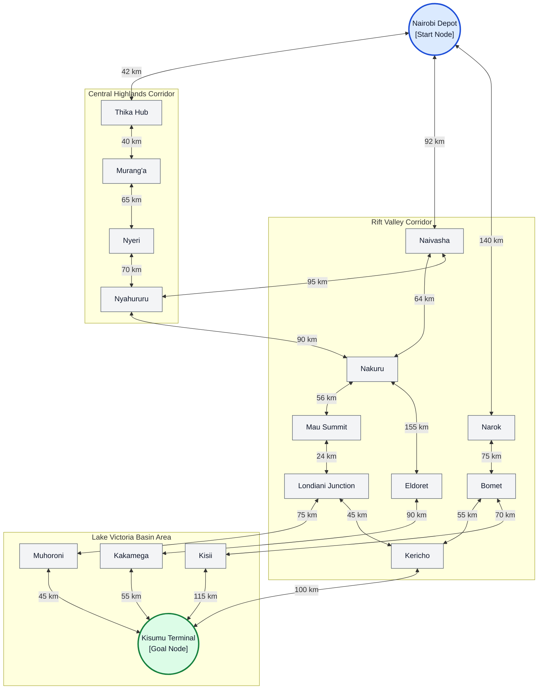
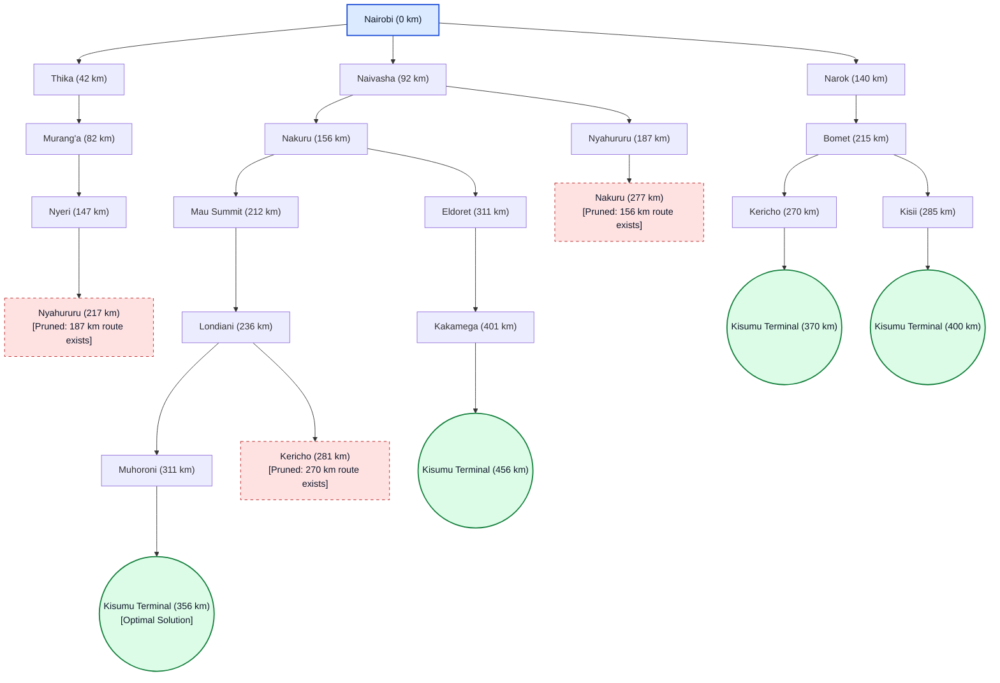

# ICS 3202: Practical Exercise 3 - Designing a Searching Agent
### Group Members
* 191718 - Yvonne Kerubo
* 190510 - Mitchelle Chepkoech
* 190158 - Juliet Kabui

## 1. PEAS Framework & Environment Definitions

### A. PEAS Framework
| Agent Component | Description |
| :--- | :--- |
| **Performance Measure** | Safety (zero collisions), fuel efficiency, shortest travel distance, punctuality, and adherence to speed limits. |
| **Environment** | Kenyan highway network (Nairobi, Central Highlands, Rift Valley, Lake Victoria Basin), dynamic traffic, pedestrians, and weather conditions. |
| **Actuators** | Steering mechanism, throttle/accelerator, service & trailer brakes, gear selection, turn signals, and horn. |
| **Sensors** | Radar, LiDAR, cameras, GPS receiver, wheel speed sensors, and Inertial Measurement Unit . |

### B. Environment Properties
1. **Partially Observable**: The agent cannot see road obstructions or dynamic traffic beyond sensor range or around blind corners.
2. **Stochastic**: The outcomes of actions are uncertain due to unpredictable weather, variable road friction, or erratic behavior of other road users.
3. **Sequential**: Every route choice made directly impacts future states and available paths down the line.
4. **Dynamic**: Traffic, weather, and pedestrians change continuous while the agent processes decisions.
5. **Multi-agent**: The trailer shares the road with other human and autonomous drivers, traffic police, and pedestrians.

---

## Question 2: Graph Construction, Abstraction Hierarchy, and Search Space Analysis

### 2.1 Formal Search Problem Formulation

To solve the navigation problem for the autonomous heavy trailer, we model the route-planning process using a formal search problem representation:

| Search Component | Formal Definition & Operational Meaning |
| :--- | :--- |
| **State Space ($S$)** | The set of discrete geographical nodes corresponding to major towns or road transit hubs along the transport corridors. |
| **Initial State ($s_0$)** | $\text{State}(\text{Nairobi})$ — The designated departure depot for the transport trailer. |
| **Goal Test ($\text{IsGoal}(s)$)** | A Boolean test checking whether $\text{CurrentState} = \text{Kisumu}$. |
| **Action Set ($A(s)$)** | The set of valid driving maneuvers to transit via paved primary roads to an adjacent connected town. |
| **Transition Model ($R(s, a)$)** | Returns the resulting neighboring town $s'$ upon executing road movement action $a$ from location $s$. |
| **Path Cost Function ($g(n)$)** | Cumulative physical distance traversing chosen highway segments, measured strictly in kilometers ($\text{km}$). |
| **Domain Abstraction** | Omission of fine-grained low-level control details (steering angles, lane choices, traffic light cycles, micro-hills, and fuel consumption) to focus strictly on macro-level topological road navigation. |

---

### 2.2 Topological Highway Network (Directed Graph Model)

The highway network spans four primary geographic zones in Kenya: Nairobi Metropolitan, Central Highlands, Rift Valley, and the Lake Victoria Basin. Nodes represent transit junctions/towns, directed edges represent highway corridors, and edge labels specify non-negative distance costs ($\text{km}$).

---

### 2.3 Layered Abstraction Architecture

To streamline complex pathfinding calculations, the trailer agent employs a two-tier abstraction architecture that decouples high-level macro routing from node-level path tracing.

#### Tier 1: Inter-Regional Macro Abstraction
At the macro level, the routing engine reasons purely in terms of transitions between broad economic and geographic sectors.

#### Tier 2: Town-Level Micro Refinement
At the refined structural layer, regional corridors unfold into precise highway connections between specific transit points with associated edge costs:

---

### 2.4 Uniform Cost Search (UCS) Execution Tree

Uniform Cost Search explores the state space in non-decreasing order of path cost $g(n)$. When duplicate nodes are reached via more expensive paths, graph search rules prune them to prevent redundant operations and suboptimal loops.

**Key Execution Observations:**
* Parenthetical numbers reflect the cumulative path cost $g(n)$ from the origin.
* **Nyahururu (217 km)** via Nyeri is dropped because an existing route reaching Nyahururu at **187 km** (via Naivasha) was already in the priority queue.
* **Nakuru (277 km)** via Nyahururu is discarded because Nakuru was previously expanded at **156 km** (via Naivasha).
* **Kericho (281 km)** via Londiani is rejected since Kericho was reached at **270 km** via Narok and Bomet.
* **Kisumu (356 km)** via Muhoroni represents the minimum cumulative distance upon popping from the priority queue.

---

### 2.5 Uniform Cost Search Node Expansion Trace Table

The table below details the step-by-step state transitions of the priority queue (frontier), sorted by $g(n)$.

| Iteration Step | Selected Dequeued Node | Cost $g(n)$ ($\text{km}$) | Frontier Operations & Graph Search Evaluation Rules |
| :---: | :--- | :---: | :--- |
| **1** | **Nairobi** | $0$ | Insert initial neighbors: Thika ($42$), Naivasha ($92$), Narok ($140$). |
| **2** | **Thika** | $42$ | Insert neighbor: Murang'a ($42+40 = 82$). |
| **3** | **Murang'a** | $82$ | Insert neighbor: Nyeri ($82+65 = 147$). |
| **4** | **Naivasha** | $92$ | Insert neighbors: Nakuru ($92+64 = 156$), Nyahururu ($92+95 = 187$). |
| **5** | **Narok** | $140$ | Insert neighbor: Bomet ($140+75 = 215$). |
| **6** | **Nyeri** | $147$ | Candidate Nyahururu ($147+70 = 217$) rejected ($187 < 217$). |
| **7** | **Nakuru** | $156$ | Insert neighbors: Mau Summit ($156+56 = 212$), Eldoret ($156+155 = 311$). |
| **8** | **Nyahururu** | $187$ | Candidate Nakuru ($187+90 = 277$) rejected ($156 < 277$). |
| **9** | **Mau Summit** | $212$ | Insert neighbor: Londiani ($212+24 = 236$). |
| **10** | **Bomet** | $215$ | Insert neighbors: Kericho ($215+55 = 270$), Kisii ($215+70 = 285$). |
| **11** | **Londiani** | $236$ | Insert neighbor: Muhoroni ($236+75 = 311$). Candidate Kericho ($236+45 = 281$) rejected ($270 < 281$). |
| **12** | **Kericho** | $270$ | Insert candidate goal state: Kisumu ($270+100 = 370$). |
| **13** | **Kisii** | $285$ | Candidate Kisumu ($285+115 = 400$) rejected ($370 < 400$). |
| **14** | **Eldoret** | $311$ | Insert neighbor: Kakamega ($311+90 = 401$). Node Muhoroni ($311$) retained at frontier. |
| **15** | **Muhoroni** | $311$ | Insert goal state: Kisumu ($311+45 = 356$), updating priority queue ($356 < 370$). |
| **16** | **Kisumu** | **356** | **Goal Test Evaluated True.** Node popped with lowest cost ($g(n) = 356$). Search terminates successfully. |

---

## Question 3: Optimal Route Evaluation and Path Cost Analysis

### 3.1 Path Cost Mathematical Formulation

The cumulative cost of a given route sequence $P = \langle s_0, s_1, s_2, \dots, s_k \rangle$ is defined as the sum of its individual segment lengths:

$$g(P) = \sum_{i=0}^{k-1} c(s_i, s_{i+1})$$

Where $c(s_i, s_{i+1})$ is the distance ($\text{km}$) between consecutive transit nodes.

---

### 3.2 Detailed Step-by-Step Breakdown of the Winning Route

**Selected Route Sequence**:  
`Nairobi → Naivasha → Nakuru → Mau Summit → Londiani → Muhoroni → Kisumu`

| Highway Segment | Traversed Corridor | Segment Length ($c$) | Running Cumulative Distance ($g(n)$) |
| :--- | :---: | :---: | :---: |
| **Nairobi → Naivasha** | A8 Primary Highway | $92\text{ km}$ | $92\text{ km}$ |
| **Naivasha → Nakuru** | A8 Primary Highway | $64\text{ km}$ | $156\text{ km}$ |
| **Nakuru → Mau Summit** | A8 Primary Highway | $56\text{ km}$ | $212\text{ km}$ |
| **Mau Summit → Londiani** | B1 Branch Corridor | $24\text{ km}$ | $236\text{ km}$ |
| **Londiani → Muhoroni** | C39 Connector Road | $75\text{ km}$ | $311\text{ km}$ |
| **Muhoroni → Kisumu** | C37 Western Access | $45\text{ km}$ | **$356\text{ km}$** |

$$\text{Total Cumulative Path Cost} = 92 + 64 + 56 + 24 + 75 + 45 = 356\text{ km}$$

---

### 3.3 Comparative Summary of All Complete Traversal Paths

| Route Corridor Option | Complete Node Sequence | Total Distance | Optimality Status |
| :--- | :--- | :---: | :---: |
| **Option A (Central Trunk)** | `Nairobi → Naivasha → Nakuru → Mau Summit → Londiani → Muhoroni → Kisumu` | **$356\text{ km}$** | **Optimal Route (Minimum Cost)** |
| **Option B (Southern Bypass)** | `Nairobi → Narok → Bomet → Kericho → Kisumu` | $370\text{ km}$ | Suboptimal ($+14\text{ km}$) |
| **Option C (South-Western Path)** | `Nairobi → Narok → Bomet → Kisii → Kisumu` | $400\text{ km}$ | Suboptimal ($+44\text{ km}$) |
| **Option D (Northern Corridor)** | `Nairobi → Naivasha → Nakuru → Eldoret → Kakamega → Kisumu` | $456\text{ km}$ | Suboptimal ($+100\text{ km}$) |

### Final Verification
Because Uniform Cost Search is optimal when all step costs are strictly non-negative ($c(s, a, s') \ge 0$), popping **Kisumu** from the priority queue at **$356\text{ km}$** guarantees that no other unexpanded or alternative path in the graph can yield a shorter distance.

